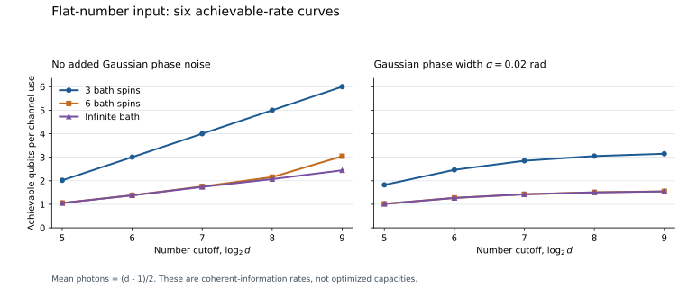

# Bosonic Phase-Noise Capacity

**How does a photon budget determine the quantum communication capacity of an oscillator with arbitrary phase noise?** This project gives a universal bounded-error answer in terms of the noise's angular histogram entropy.

The channel applies an independent random phase rotation on each use. Its phase distribution $`\mu`$ may be discrete, continuous, singular, or mixed. Let $`Q_\mu(E)`$ be its unassisted quantum capacity under a mean photon-number budget $`E`$, and let $`H_m(\mu)`$ be the Shannon entropy of the phase after dividing the circle into $`m`$ equal bins. For $`E\ge1`$,

```math
\boxed{
Q_\mu(E)=\log_2 E-H_{\lceil E\rceil}(\mu)+O(1).
}
```

The error is bounded independently of energy and the noise law. More explicitly, with $`m=\lceil E\rceil`$ and $`D_m=\log_2m-H_m`$,

```math
D_m-C
\le I_c(u_m,\mathcal N_\mu)
\le Q_\mu(E)
\le D_m+C+3,
\qquad C=3.0037918581\ldots.
```

Here $`u_m`$ is the input uniform on the first $`m`$ photon-number levels. It gives an achievable rate within a universal additive constant of the optimum. The constants are conservative; this is a scaling and approximation theorem, not an exact capacity formula or a practical coding construction.

## What the result explains

The entropy of the phase noise at resolution $`1/E`$ determines how much of the oscillator's logarithmic communication potential is lost. If the noise has information dimension $`d_I`$, then

```math
\lim_{E\to\infty}\frac{Q_\mu(E)}{\log_2 E}=1-d_I.
```

The finite-resolution theorem also applies when this dimension does not exist. A geometric spin bath illustrates why the distinction between finite and infinite noise models matters. For $`K`$ fair spins with geometric coupling ratio $`r\gt2`$, set $`\delta=1/\log_2r`$. With independent Gaussian phase broadening of width $`s`$ in cycles, write $`F=\min\{E,1/s\}`$. Then

```math
Q_{\mu_K*G_s}(E)
=\log_2 F-\min\{K,\delta\log_2 F\}+O_r(1).
```

The error is uniform in energy, bath size and broadening width in the stated small-width range. A finite bath eventually becomes fully resolved; continuous background broadening eventually sets a capacity ceiling. The [physical analysis](science/04-bath-and-smoothing.md) gives the precise ranges, proof and interpretation.

## Read the science

Start with the [scientific route](science/README.md), or go directly to the relevant part.

| Question | Scientific account |
|---|---|
| What exactly is the channel and mean-energy constraint? | [Model and coding problem](science/01-model.md) |
| Why does phase rounding have only a constant entropy cost? | [Phase-quantization proof](science/02-phase-quantization.md) |
| Why can no photon-number distribution beat the law by an unbounded amount? | [Capacity theorem and full-tail converse](science/03-capacity.md) |
| What changes for finite baths and added smooth noise? | [Bath and smoothing crossovers](science/04-bath-and-smoothing.md) |
| What does the result establish, and what lies outside its scope? | [Physical and information-theoretic interpretation](science/05-interpretation.md) |
| Which ingredients and nearby conclusions were already known? | [Related work](references/related-work.md) and [bibliography](references/sources.bib) |

The two decisive steps are an input-uniform entropy comparison with a finite cyclic phase channel and a decomposition into photon-number shells that controls all mean-energy tails. The proof does not impose a hard cutoff on the allowed code.

## Reproduce the finite checks

From the repository root, install the documented [dependencies](verification/requirements.txt) and run:

```bash
python3 verification/run_all.py
```

The [verification guide](verification/README.md) specifies the checks, expected outputs and numerical error accounting. The stored examples evaluate coherent information of flat number inputs. They support phase, energy and entropy conventions and illustrate the crossovers; the general capacity converse is proved analytically.



Each point uses a uniform input on $`d`$ photon-number levels, with mean energy $`(d-1)/2`$. The curves show achievable rates, not numerical evaluations of the optimized capacity. The [plot generator](verification/make_plot.py) reads the committed numerical data.

## Attribution and scope

The energy-constrained coding theorem, cyclic dephasing capacity, product-Hamiltonian entangling-rate bound, spectral-dimension entropy mechanism and geometric spin-bath construction are established ingredients. The [source comparison](references/related-work.md) identifies them and explains the additional optimized finite-energy conclusion. The comparison includes the October 2026 finite-energy bosonic-dephasing characterization, which leaves an optimization over photon distributions.

The result concerns independent uses of a known pure-dephasing channel, without access to the realized phase or two-way classical assistance. The mean photon budget is unconditional and averaged across uses. Fresh or independently reset baths are needed for the independent-use spin model. Photon loss, one shared static bath, unknown noise parameters, finite-blocklength performance and efficient encoder implementation are separate questions. No strong-converse statement is made.

## Purpose and contact

This repository serves as a record of the work and a guide for the author’s self-directed learning. For discussion or potential collaboration, please contact Ruge Lin at [gogoko699@gmail.com](mailto:gogoko699@gmail.com).
