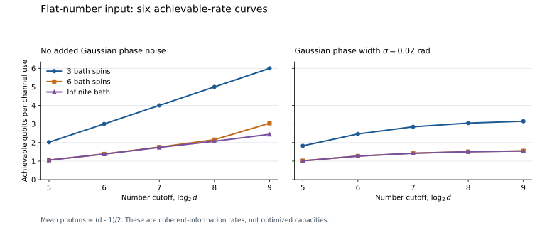

# Reproduce the flat-input calculation

This directory reproduces the six prescribed flat-number input curves used in the scientific account. It contains **30 numerical points**: five cutoffs, three bath sizes, and two Gaussian phase widths. It does not search for the capacity-maximizing photon distribution.

For a flat number input on $`0,\ldots,d-1`$, the mean photon number is $`(d-1)/2`$ and the coherent information is

```math
I_c(u_d)=\log_2d-S(T_d/d),
\qquad
(T_d)_{nm}
=e^{-\sigma^2(n-m)^2/2}
\prod_{k=1}^{K}\cos\!\left(\frac{2\pi(n-m)}{3^k}\right).
```

The Gaussian width $`\sigma`$ is in **radians**. The centered spin convention in this formula differs from the usual Cantor digits by a known phase rotation, which does not change the entropy. The code evaluates a coherent-information rate achievable by ordinary coding across independent uses. These rates are not numerical estimates of the optimized capacity.

## Run the checks

From the repository root, using Python 3.12 and the pinned numerical dependencies:

```bash
python -m pip install -r verification/requirements.txt
python verification/run_all.py
```

The default command recomputes all 30 points, verifies that the committed JSON and CSV agree, compares the recomputation against them, and checks two exact endpoints. It leaves both reference-data files unchanged. The observed package versions are recorded in [environment.json](environment.json).

The [recorded execution](last-run.txt) passed all 30 reference comparisons and both exact endpoints. The largest rate/entropy difference from the saved reference was zero in that environment. Each endpoint rate error was about $`8.88\times10^{-16}`$ bits. The largest trace error was $`4.44\times10^{-16}`$, and the smallest computed eigenvalue was $`-1.28\times10^{-15}`$.

The fixed parameter set is:

| Parameter | Values |
|---|---|
| Number cutoff $`d`$ | 32, 64, 128, 256, 512 |
| Number of bath spins $`K`$ | 3, 6, infinite |
| Gaussian width $`\sigma`$ in radians | 0, 0.02 |
| Spins retained for the infinite product | 18 |

The two additional checks use $`d=32`$. A deterministic zero phase must give the identity-channel rate $`\log_2d`$. A uniform law on the $`d`$ cyclic phases must give rate zero. Together they check the phase-period, matrix-normalization, and entropy conventions without extending the physical parameter study.

If a reference update is intentional, the explicit command is:

```bash
python verification/run_all.py --write-reference
```

This replaces both reference-data files after recomputing the suite and checking the exact endpoints. Such an update should be reviewed as a data change; it is not part of ordinary verification.

## Numerical tolerances and the analytic tail bound

The rate and entropy comparison uses absolute tolerance **$`10^{-9}`$ bits**, with zero relative tolerance. The normalized rate field uses the same numerical tolerance. Analytic tail-bound values are compared separately with relative tolerance $`10^{-12}`$ and absolute tolerance $`10^{-20}`$.

Every matrix evaluation also requires minimum computed eigenvalue at least $`-10^{-11}`$ and trace error at most $`10^{-10}`$. Eigenvalues at or below $`10^{-15}`$ do not contribute to the floating-point entropy sum. These are numerical diagnostics, not interval-certified error bounds. They are reported separately from the following mathematical truncation estimate.

For an infinite bath truncated after $`L`$ spins,

```math
\left|1-\prod_{k>L}\cos\!\left(\frac{2\pi\ell}{3^k}\right)\right|
\le\frac12\sum_{k>L}\left(\frac{2\pi\ell}{3^k}\right)^2
=\frac{\pi^2\ell^2}{4\,9^L}.
```

This follows from $`|1-\prod a_k|\le\sum|1-a_k|`$ for $`|a_k|\le1`$ and $`1-\cos x\le x^2/2`$. Multiplication by the retained spin product and Gaussian factor cannot enlarge the coefficient error. At a cutoff $`d`$, write

```math
\epsilon_c=\frac{\pi^2(d-1)^2}{4\,9^L},
\qquad
\frac12\|T_d^{(\infty)}/d-T_d^{(L)}/d\|_1
\le\frac{\sqrt d}{2}\epsilon_c=:t.
```

The normalized entrywise error gives a Frobenius-norm error at most $`\epsilon_c`$; the trace-norm bound then uses rank at most $`d`$. Audenaert's entropy inequality [A] gives

```math
|\Delta S|\le t\log_2(d-1)+h_2(t)
```

throughout the range of this suite. The implementation uses the trivial bound $`\log_2d`$ if a general call produces a distance bound outside this expression's monotonicity range. With $`L=18`$ and the stated five cutoffs, the largest analytic entropy error is approximately **$`2.17\times10^{-9}`$ bits**.

This bound controls replacing an exact infinite product by an exact finite product. It does **not** include floating-point evaluation or eigensolver errors. Agreement with the saved reference data is a reproducibility check, not a proof of the capacity theorem or an independent numerical certificate of every displayed digit.

## Optional figure

```bash
python -m pip install -r verification/requirements-plot.txt
python verification/make_plot.py
```

The plotting command reads the committed reference data and writes [flat-input-rates.svg](flat-input-rates.svg). It does not recompute the matrices. The SVG is self-contained, with vector paths and no external font or image dependency.



**Figure.** Flat-number coherent-information rates at $`d=32,64,128,256,512`$, with three bath sizes in each panel. The left panel has no added Gaussian phase; the right has $`\sigma=0.02`$ radians. The horizontal coordinate is $`\log_2d`$, and the input mean photon number is $`(d-1)/2`$. The curves are achievable rates, not optimized capacities. The infinite-bath approximation has the analytic truncation bound above; floating-point diagnostics are separate. The finite curves illustrate the predicted regimes but do not establish an asymptotic slope.

## Files

| File | Role |
|---|---|
| [phase_noise.py](phase_noise.py) | Reusable characteristic-function, entropy, tail-bound, and suite functions |
| [run_all.py](run_all.py) | Default comparison against committed data and exact endpoint checks |
| [reference-data.csv](reference-data.csv) | All 30 parameter/result rows |
| [reference-data.json](reference-data.json) | The same rows with scope and diagnostic summaries |
| [make_plot.py](make_plot.py) | Optional SVG renderer using the saved data |
| [requirements.txt](requirements.txt) | Pinned NumPy and SciPy versions |
| [requirements-plot.txt](requirements-plot.txt) | Optional plotting dependency |
| [environment.json](environment.json) | Versions observed when the calculation was prepared |

**[A]** K. M. R. Audenaert, *A sharp continuity estimate for the von Neumann entropy*, Journal of Physics A: Mathematical and Theoretical **40**, 8127–8136 (2007). [Primary manuscript, arXiv:quant-ph/0610146](https://arxiv.org/abs/quant-ph/0610146). The finite-dimensional entropy continuity inequality is used only to certify the infinite-product truncation in this numerical illustration.
